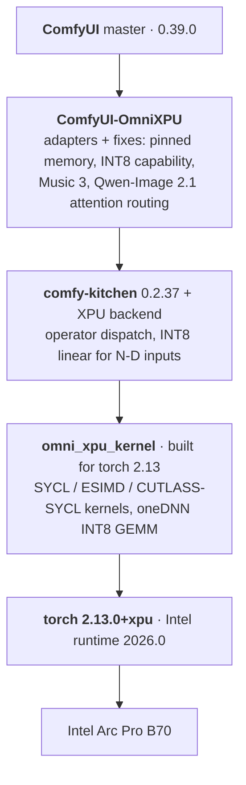

<div align="center">

# comfyui-b70-xpu

**Current ComfyUI on an Intel Arc Pro B70, with the fast paths actually in use.**

[](https://github.com/igerry/comfyui-b70-xpu/releases/tag/omni-0.1.0-b1)
[](https://hub.docker.com/r/gerrywang/comfyui-b70-xpu/tags)
[](omni/docs/IMAGE_BUILD.md)
[](https://github.com/comfyanonymous/ComfyUI)
[](https://download.pytorch.org/whl/xpu)
[](#scope-and-limits)
[](LICENSE)

**English** · [简体中文](README.zh-CN.md)

[Quick start](#quick-start) · [Results](#results) · [Models](#supported-models) · [What's inside](#whats-inside) · [Docs](#documentation)

</div>

---

Intel's ComfyUI image for Arc cards ([`intel/llm-scaler-omni`](https://github.com/intel/llm-scaler)) is fast, but
the published release is frozen at ComfyUI 0.31 and torch 2.11. This project moves the same XPU
acceleration stack to **upstream ComfyUI master on torch 2.13**, repairs what the upgrade silently
broke, and adds kernels and fixes of its own. It ships as a **10.8 GB Docker image** built from
Intel's, with the same mount points and run commands.

Measured on one Arc Pro B70 (32 GB) with four models: **MiniMax H3**, **Krea-2 Turbo**,
**Qwen-Image 2.1** and **MiniMax Music 3**.

## Highlights

| | |
|---|---|
| ⚡ **Faster than Intel's image on H3** | −17 to −20% per video at 480×864 and −12 to −13% at 704×1280, with a new prompt each time |
| 🧩 **Runs models the published image cannot** | Qwen-Image 2.1 (needs ComfyUI ≥ 0.37), plus tuned paths for Music 3 and Krea-2 |
| 📌 **Pinned host memory on Intel GPUs** | ComfyUI only enables it for NVIDIA and AMD. Here: 26.8 GB/s host→device instead of 1.9 GB/s |
| 🔢 **INT8 fast path for every model** | Three of four models were falling off it. INT8 weights now run 21 – 49% faster than float |
| 🎯 **Same seed, same video** | Traced a run-to-run difference to its source and made reproducible output the default |
| ✅ **A validator that checks the real thing** | A green startup log proved nothing on three regressions; `validate_comfyui_image.sh` loads the kernels |

## Results

<p align="center">
  
</p>

<p align="center">
  
</p>

> [!NOTE]
> **"New prompt" is what a real job costs.** ComfyUI caches node outputs by input, so re-running
> with only a new seed skips the text encoder and the model swaps around it. Times are server-side
> (`execution_start` → `execution_success`). Same card, same day, same workflow for both stacks.
> Every table, the test machine and the method: **[BENCHMARKS.md](omni/docs/BENCHMARKS.md)**.

The published image was verified as a user gets it: pulled anonymously from Docker Hub onto a
machine with no local copy, then the full suite run inside it. It matches the bare-metal numbers
(H3 55.6 – 55.7 s vs. 55.7 – 56.0 s, and likewise for the other three models).

## Quick start

**Requirements:** Linux, an Intel Arc B-series GPU with working drivers, Docker.

```bash
# 1. Pull (10.8 GB in 17 layers, 4.05 GB to download)
docker pull gerrywang/comfyui-b70-xpu:0.1.0-b1

# 2. Validate: kernels load, GPU is visible, INT8 is native
docker run --rm --device=/dev/dri gerrywang/comfyui-b70-xpu:0.1.0-b1 \
    /llm/entrypoints/validate_comfyui_image.sh

# 3. Run
docker run -itd --name comfyui \
    --device=/dev/dri --network=host --shm-size=16g --memory=96g \
    -v /path/to/comfyui_models:/models/host:ro \
    -v /path/to/comfyui_input:/data/input \
    -v /path/to/comfyui_output:/data/output \
    -v /path/to/comfyui_user:/data/user \
    gerrywang/comfyui-b70-xpu:0.1.0-b1
```

Open `http://<host>:8188`. Mount points and flags are the ones Intel documents for its image.

> [!IMPORTANT]
> **Set `--memory` to the RAM ComfyUI may count on**: the machine's RAM, or the LXC container's
> memory size when Docker runs inside LXC. Pinned memory uses up to 90% of it. Nested in LXC,
> Docker reports the physical host's RAM: on the test machine the budget came out as 917 GB
> instead of 80 GB until `--memory=96g` was passed.

<details>
<summary><b>More run options</b></summary>

- **`--privileged`**: all of our runs added it (the test host is an LXC container and needs it).
  Without it the image is untested, pinned memory in particular.
- **Less than about 64 GB of RAM**: add `-e OMNIXPU_PIN_MEMORY=0`. H3 alone keeps about 52 GB pinned.
- **Custom nodes**: mount them one by one into `/llm/ComfyUI/custom_nodes/<name>` (do not mount
  over the whole directory, it holds `ComfyUI-OmniXPU`) and install their requirements with
  `docker exec comfyui pip install ...`.
- **Arguments**: a command after the image name replaces the default one.
  `/llm/entrypoints/start_comfyui.sh --lowvram` passes `--lowvram` to `main.py`;
  `python main.py ...` works as with Intel's image.
- **Symlinked model directories**: also mount the link targets at the same absolute path.

</details>

<details>
<summary><b>Build it yourself</b></summary>

```bash
git clone https://github.com/igerry/comfyui-b70-xpu.git
cd comfyui-b70-xpu/omni
bash build.sh                 # -> comfyui-b70-xpu:0.1.0-b1-comfyui-bmg
```

Needs BuildKit, about 45 GB of free disk (Intel's base image is 21 GB) and internet access. The
native kernels compile in about 3 minutes on 16 threads. Stages, variables and a bare-metal
install without Docker: [IMAGE_BUILD.md](omni/docs/IMAGE_BUILD.md).

</details>

<details>
<summary><b>Check that the fast paths are in use</b></summary>

```bash
docker logs comfyui 2>&1 | grep -E "OmniXPU|Native ops"
```

1. `[OmniXPU] omni_xpu_kernel 0.2.0b1+torch213.bmg - available: sdp, norm, rotary, linear_fp8, int8`
2. `Native ops: ...` lists `int8_tensorwise` and `convrot_w4a4`. Under `emulated ops` they mean
   INT8 weights are being de-quantised and computed in floating point.
3. After a workflow, `python3 omni/benchmarks/xpu_status.py` prints the routing counters.

</details>

## Supported models

Model files are not downloaded for you. Mount your ComfyUI model directory; file names are listed
in [COMFYUI.md](omni/docs/COMFYUI.md).

| Model | Weights to use on a B70 | Typical time | Why |
|---|---|---|---|
| **MiniMax H3**, 6 steps, 124 frames with audio | INT8 main model; fp16 video VAE at 480p, INT8 VAE at 704×1280 | 70 – 72 s at 480×864 | The INT8 VAE gains nothing at 480p once the prompt changes |
| **Krea-2 Turbo**, 8 steps, 1024² | **INT8** | 7.6 s | Model and text encoder fit in VRAM together, so a new prompt no longer swaps them |
| **Qwen-Image 2.1**, 25 steps, 1280×720 | **INT8** | 10.3 – 10.6 s | Same quality tier (PSNR 35 dB vs. float) |
| **Qwen-Image 2.1 + Viggle Turbo**, 6 steps | **bf16** | 5.1 s | On INT8 faces turn grey and soft |
| **MiniMax Music 3**, 2 minutes, 30 steps | **INT8 DiT**, bf16 text encoder | 87 – 90 s per new song | The INT8 text encoder is not faster and changes the audio |

## What's inside



| Area | What changed | Measured effect |
|---|---|---|
| **Compatibility with ComfyUI 0.39** | XPU reported as INT8-capable again; `int8_linear` and `pin_memory` follow upstream's new signatures | H3 sampling 7.3 → 6.2 s/step; Qwen-Image 2.1 no longer crashes on step 1 |
| **Pinned host memory** | Enabled for XPU, with a copy-and-swap implementation | H3 with a new prompt: 81 – 83 s → 69 – 74 s |
| **INT8 fast path for N-D inputs** | Inputs are flattened to 2-D before the fused rotate + quantise + GEMM kernel | Qwen-Image 2.1 11.6 → 10.3 s; Krea-2 7.4 → 6.9 s; Music 3 66.8 → 61.8 s |
| **Music 3** | Window batching, dense partial RoPE, GLU folded into the INT8 down-projection | 88.4 → 79.0 s (fp16) → 53.2 s (INT8 DiT) |
| **Qwen-Image 2.1** | Large attention routed to the CUTE kernel above a key-length threshold | 2048²: 76.7 → 67.8 s |
| **H3 native kernels** | Fused ConvRot quantisation v2, RMSNorm + AdaLN, RoPE subgroup kernel, producer fusions, VAE attention tile | Same-seed 480p: 58.0 → 56.3 s |
| **Reproducibility** | The two H3 in-layer fusions that amplify an upstream 1e-6 perturbation are off by default | Same seed: identical frames in 6 of 6 runs, for under 1 s |

Each row in detail, with microbenchmarks, numerics and the things that did **not** help
(torch 2.14, FP8 weights, a faster attention kernel, …): **[OPTIMIZATIONS.md](omni/docs/OPTIMIZATIONS.md)**.

## Configuration

Environment variables, read at startup. `0` disables. The full list is in [COMFYUI.md](omni/docs/COMFYUI.md#runtime-switches).

| Variable | Default | What it does |
|---|---|---|
| `OMNIXPU_PIN_MEMORY` | 1 | Pinned host memory |
| `OMNIXPU_BLOCK_FUSED`, `OMNIXPU_ADALN_FUSED` | **0** | H3 in-layer fusions: under 1 s faster per video, but the same seed no longer reproduces |
| `OMNIXPU_MUSIC3_BATCH`, `_ROPE`, `_GLU` | 1 | The three Music 3 optimizations |
| `OMNIXPU_QWEN21_CUTE_MIN_KV` | 7168 | Key length from which Qwen-Image 2.1 attention uses the CUTE kernel |
| `OMNIXPU_DEBUG` | 0 | Trace every kernel route and fallback |

## Scope and limits

- Tested on **one** Arc Pro B70. The kernels are compiled for `bmg`, which also covers B580 and
  B60, but nothing here was run on them.
- Tested with the four models above. Other models run through the same layers but were not measured.
- Compared against Intel's **published** `0.2.0-b1` image. Intel's `main` branch carries an
  unpublished `0.2.0-b2` source build (ComfyUI 0.39 / torch 2.14) that we have not built or
  measured; the comparison should be redone when it ships.
- On Intel's image we benchmarked only H3. Krea-2 runs there too; Qwen-Image 2.1 cannot load on its ComfyUI 0.31.
- The stack is pinned (ComfyUI commit, comfy-kitchen 0.2.37, torch 2.13.0). The upgrade checklist
  is in [IMAGE_BUILD.md](omni/docs/IMAGE_BUILD.md#upgrading-comfyui-later).
- The power limit was left at the rated 230 W. This is a working setup published as-is.

## Documentation

| | |
|---|---|
| [BENCHMARKS.md](omni/docs/BENCHMARKS.md) | Test machine, method, every table, the in-container verification |
| [OPTIMIZATIONS.md](omni/docs/OPTIMIZATIONS.md) | Each change in detail, and what did not help |
| [COMFYUI.md](omni/docs/COMFYUI.md) | Model files, workflows, custom nodes, all runtime switches |
| [IMAGE_BUILD.md](omni/docs/IMAGE_BUILD.md) | Build stages and variables, acceptance, bare-metal install, upgrade checklist |
| [omni/README.md](omni/README.md) | The image, in the format of Intel's `omni/README.md` |
| [Releases.md](Releases.md) · [release notes](omni/docs/RELEASE_NOTES_0.1.0-b1.md) | Versions and what each contains |

<details>
<summary><b>Repository layout</b> (same shape as <code>intel/llm-scaler</code>)</summary>

```
README.md, README.zh-CN.md   this page
Releases.md                  list of releases
omni/
  build.sh                   builds the image (reads omni/VERSION)
  docker/Dockerfile          FROM intel/llm-scaler-omni:0.2.0-b1, final image FROM scratch
  entrypoints/               start_comfyui.sh, validate_comfyui_image.sh
  configs/                   comfyui_host_models.yaml (models mounted at /models/host)
  tools/                     validate_comfyui_image.py, split_layers.py
  omni_xpu_kernel/           native kernels, full source with our changes
  ComfyUI-OmniXPU/           ComfyUI node, full source with our adapters and fixes/
  patches/                   comfy-kitchen XPU backend, sycl-tla; vs-intel-0.2.0-b1/ = our delta
  benchmarks/                the scripts behind the tables; kernel/ has microbenchmarks and probes
  assets/                    README charts and the script that draws them
  docs/                      the documents above; history/ = step-by-step patch scripts
```

</details>

## License and credits

Apache-2.0, the licence of `intel/llm-scaler`. What we changed in the upstream sources, and the
BSD-3-Clause part, are listed in [NOTICE.md](NOTICE.md). Version numbers are our own; each release
states which Intel image it is built from.

This work stands on [intel/llm-scaler](https://github.com/intel/llm-scaler) (`omni_xpu_kernel`,
`ComfyUI-OmniXPU`, the Docker image), [intel/sycl-tla](https://github.com/intel/sycl-tla),
[xiangyuT/comfy-kitchen-xpu](https://github.com/xiangyuT/comfy-kitchen-xpu),
[Comfy-Org/comfy-kitchen](https://github.com/Comfy-Org/comfy-kitchen) and
[ComfyUI](https://github.com/comfyanonymous/ComfyUI). It is an independent project, not
affiliated with or endorsed by any of them.
