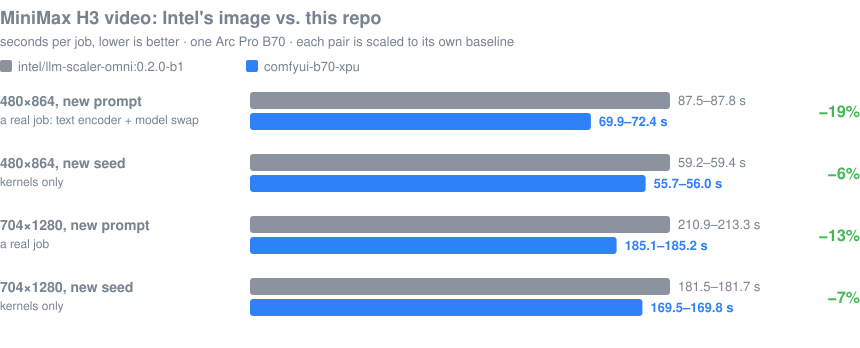
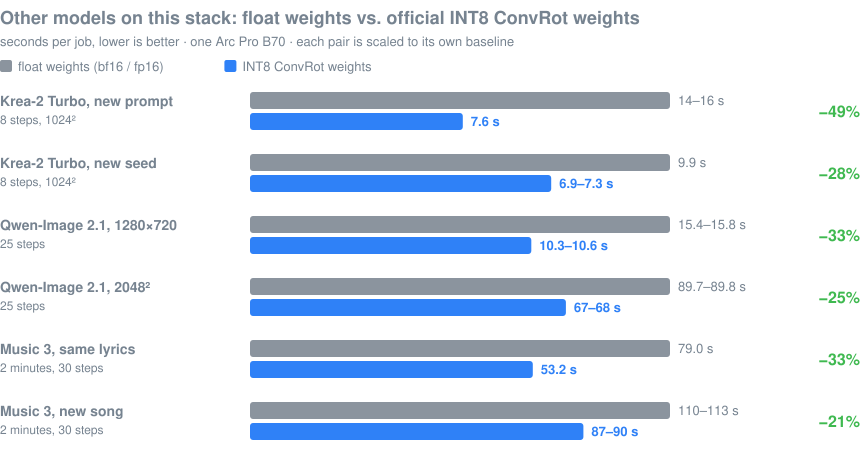
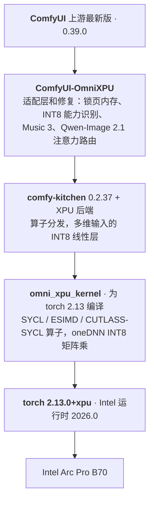

<div align="center">

# comfyui-b70-xpu

**让最新版 ComfyUI 在 Intel Arc Pro B70 上跑起来，并且真的走在快路径上。**

[](https://github.com/igerry/comfyui-b70-xpu/releases/tag/omni-0.1.0-b1)
[](https://hub.docker.com/r/gerrywang/comfyui-b70-xpu/tags)
[](omni/docs/IMAGE_BUILD.md)
[](https://github.com/comfyanonymous/ComfyUI)
[](https://download.pytorch.org/whl/xpu)
[](#适用范围和局限)
[](LICENSE)

[English](README.md) · **简体中文**

[快速开始](#快速开始) · [实测结果](#实测结果) · [支持的模型](#支持的模型) · [里面有什么](#里面有什么) · [文档](#文档)

</div>

---

Intel 官方给 Arc 显卡做的 ComfyUI 镜像（[`intel/llm-scaler-omni`](https://github.com/intel/llm-scaler)）速度不错，
但已发布的版本停在 ComfyUI 0.31 和 torch 2.11。这个项目把同一套 XPU 加速层搬到了
**ComfyUI 上游最新版 + torch 2.13** 上，修好升级时悄悄坏掉的地方，再加上我们自己写的算子和修复。
成品是一个 **10.8 GB 的 Docker 镜像**，从官方镜像构建而来，挂载点和运行命令与官方一致。

在一张 Arc Pro B70（32 GB）上实测了四个模型：**MiniMax H3**、**Krea-2 Turbo**、
**Qwen-Image 2.1**、**MiniMax Music 3**。

## 要点

| | |
|---|---|
| ⚡ **H3 比官方镜像快** | 每次都换提示词的情况下，480×864 每条视频快 17% 到 20%，704×1280 快 12% 到 13% |
| 🧩 **能跑已发布的官方镜像跑不了的模型** | Qwen-Image 2.1（需要 ComfyUI 0.37 以上），并为 Music 3 和 Krea-2 做了专门的优化 |
| 📌 **Intel 显卡上的锁页内存** | ComfyUI 只给 NVIDIA 和 AMD 开启。开启后主机到显卡的拷贝从 1.9 GB/s 变成 26.8 GB/s |
| 🔢 **每个模型都走 INT8 快路径** | 四个模型里原本有三个掉出了快路径。现在 INT8 权重比浮点权重快 21% 到 49% |
| 🎯 **同一个种子出同一条视频** | 查到了跑间差异的源头，并把可复现的输出设为默认 |
| ✅ **验收脚本查的是真东西** | 三次回退发生时启动日志都是全绿的；`validate_comfyui_image.sh` 会真的去加载算子 |

## 实测结果

<p align="center">
  
</p>

<p align="center">
  
</p>

图中 new prompt 是「换提示词」，new seed 是「只换种子」；灰色是对照，蓝色是本仓库或 INT8 权重；单位是秒，越短越好。

> [!NOTE]
> **「换提示词」才是一个真实任务的耗时。** ComfyUI 按输入缓存节点的输出，只换种子重跑会跳过文本编码器
> 以及围绕它的模型换进换出。时间取服务端记录的执行时间；两套环境用的是同一张卡、同一天、同一份工作流。
> 全部表格、测试机和测法见 **[BENCHMARKS.md](omni/docs/zh/BENCHMARKS.md)**。

镜像单独验证过：在容器里跑的全套基准与裸机数字一致（H3 是 55.1 – 55.7 秒对 55.7 – 56.0 秒，另外三个模型同样吻合）。

## 快速开始

**要求：** Linux，Intel Arc B 系列显卡且驱动正常，装有 Docker。

```bash
# 1. 拉取（10.8 GB，17 层，下载量约 5.5 GB）
docker pull gerrywang/comfyui-b70-xpu:0.1.0-b1

# 2. 验收：算子能加载、显卡可见、INT8 是原生格式
docker run --rm --device=/dev/dri gerrywang/comfyui-b70-xpu:0.1.0-b1 \
    /llm/entrypoints/validate_comfyui_image.sh

# 3. 运行
docker run -itd --name comfyui \
    --device=/dev/dri --network=host --shm-size=16g --memory=96g \
    -v /path/to/comfyui_models:/models/host:ro \
    -v /path/to/comfyui_input:/data/input \
    -v /path/to/comfyui_output:/data/output \
    -v /path/to/comfyui_user:/data/user \
    gerrywang/comfyui-b70-xpu:0.1.0-b1
```

之后访问 `http://<主机>:8188`。挂载点和参数就是官方文档里给官方镜像写的那一套。

> [!IMPORTANT]
> **`--memory` 要填 ComfyUI 可以指望的内存**：物理机的内存；Docker 跑在 LXC 里时，填 LXC 的内存大小。
> 锁页内存最多会用掉它的 90%。嵌套在 LXC 里的 Docker 看到的是物理机的内存：在测试机上，
> 不加这个参数时预算被算成了 917 GB，加上 `--memory=96g` 后才是 80 GB。

<details>
<summary><b>更多运行选项</b></summary>

- **`--privileged`**：我们所有的运行都加了它（测试机是 LXC 容器，必须加）。不加的情况没有测过，尤其是锁页内存。
- **内存少于 64 GB 左右**：加 `-e OMNIXPU_PIN_MEMORY=0`。只跑 H3 就会锁住约 52 GB。
- **自定义节点**：把节点一个个挂到 `/llm/ComfyUI/custom_nodes/<名字>`（不要整个目录覆盖挂载，
  里面有 `ComfyUI-OmniXPU`），依赖用 `docker exec comfyui pip install ...` 装。
- **参数**：镜像名后面写命令会替换默认命令。`/llm/entrypoints/start_comfyui.sh --lowvram`
  会把 `--lowvram` 传给 `main.py`；也可以像用官方镜像那样自己写 `python main.py ...`。
- **模型目录里有软链接**：把链接指向的目录也按相同的绝对路径挂进去。

</details>

<details>
<summary><b>自己构建</b></summary>

```bash
git clone https://github.com/igerry/comfyui-b70-xpu.git
cd comfyui-b70-xpu/omni
bash build.sh                 # 得到 comfyui-b70-xpu:0.1.0-b1-comfyui-bmg
```

需要 BuildKit、约 45 GB 空闲磁盘（官方基础镜像 21 GB）以及构建时能联网。原生算子在 16 线程上约 3 分钟编完。
构建阶段、可调变量、不用 Docker 的裸机安装见 [IMAGE_BUILD.md](omni/docs/IMAGE_BUILD.md)（英文）。

</details>

<details>
<summary><b>确认快路径真的在用</b></summary>

```bash
docker logs comfyui 2>&1 | grep -E "OmniXPU|Native ops"
```

1. 有这一行：`[OmniXPU] omni_xpu_kernel 0.2.0b1+torch213.bmg - available: sdp, norm, rotary, linear_fp8, int8`
2. `Native ops: ...` 里有 `int8_tensorwise` 和 `convrot_w4a4`。如果它们出现在 `emulated ops` 里，
   说明 INT8 权重正在被反量化成浮点来算。
3. 跑过一个工作流之后，`python3 omni/benchmarks/xpu_status.py` 会打印路由计数。

</details>

## 支持的模型

模型文件不会自动下载，请挂载你自己的 ComfyUI 模型目录；文件名列在 [COMFYUI.md](omni/docs/COMFYUI.md)（英文）。

| 模型 | 在 B70 上该用的权重 | 典型耗时 | 原因 |
|---|---|---|---|
| **MiniMax H3**，6 步，124 帧带声音 | 主模型 INT8；视频 VAE 在 480p 用 fp16，704×1280 用 INT8 | 480×864 是 70 – 72 秒 | 480p 下只要换了提示词，INT8 VAE 就没有收益 |
| **Krea-2 Turbo**，8 步，1024² | **INT8** | 7.6 秒 | 主模型和文本编码器能同时留在显存里，换提示词不用再换进换出 |
| **Qwen-Image 2.1**，25 步，1280×720 | **INT8** | 10.3 – 10.6 秒 | 画质同档（和浮点比 PSNR 35 dB） |
| **Qwen-Image 2.1 + Viggle Turbo**，6 步 | **bf16** | 5.1 秒 | INT8 上人脸发灰发糊 |
| **MiniMax Music 3**，两分钟，30 步 | **DiT 用 INT8**，文本编码器用 bf16 | 每首新歌 87 – 90 秒 | 文本编码器换 INT8 不更快，而且音频会变 |

## 里面有什么



| 方面 | 改了什么 | 实测效果 |
|---|---|---|
| **兼容 ComfyUI 0.39** | 让 XPU 重新被识别为支持 INT8；`int8_linear` 和 `pin_memory` 跟上上游的新签名 | H3 采样每步 7.3 → 6.2 秒；Qwen-Image 2.1 不再第一步就崩 |
| **锁页内存** | 在 XPU 上启用，用「拷贝再换存储」的方式实现 | H3 换提示词：81 – 83 秒 → 69 – 74 秒 |
| **多维输入也走 INT8 快路径** | 输入先摊平成二维，再进「旋转 + 量化 + 矩阵乘」的融合算子 | Qwen-Image 2.1 11.6 → 10.3 秒；Krea-2 7.4 → 6.9 秒；Music 3 66.8 → 61.8 秒 |
| **Music 3** | 窗口并批、稠密的部分 RoPE、GLU 并进 INT8 下投影 | 88.4 → 79.0 秒（fp16）→ 53.2 秒（INT8 DiT） |
| **Qwen-Image 2.1** | 键长超过阈值时，大尺寸注意力交给 CUTE 算子 | 2048²：76.7 → 67.8 秒 |
| **H3 原生算子** | 融合 ConvRot 量化 v2、RMSNorm + AdaLN、RoPE 子组算子、生产者融合、VAE 注意力分块 | 480p 只换种子：58.0 → 56.3 秒 |
| **可复现性** | 两个 H3 层内融合会放大上游的 1e-6 扰动，默认关闭 | 同种子 6 次里 6 次画面逐帧相同，代价不到 1 秒 |

每一项的细节、微基准、数值影响，以及**没有用**的方向（torch 2.14、FP8 权重、更快的注意力算子等）：
**[OPTIMIZATIONS.md](omni/docs/zh/OPTIMIZATIONS.md)**。

## 配置

环境变量，启动时读取，`0` 为关。完整列表在 [COMFYUI.md](omni/docs/COMFYUI.md#runtime-switches)（英文）。

| 变量 | 默认 | 作用 |
|---|---|---|
| `OMNIXPU_PIN_MEMORY` | 1 | 锁页内存 |
| `OMNIXPU_BLOCK_FUSED`、`OMNIXPU_ADALN_FUSED` | **0** | H3 的层内融合：每条视频快不到 1 秒，但同一个种子不再可复现 |
| `OMNIXPU_MUSIC3_BATCH`、`_ROPE`、`_GLU` | 1 | Music 3 的三项优化 |
| `OMNIXPU_QWEN21_CUTE_MIN_KV` | 7168 | Qwen-Image 2.1 的注意力从多长的键开始走 CUTE 算子 |
| `OMNIXPU_DEBUG` | 0 | 打印每一次算子路由和回退 |

## 适用范围和局限

- 只在**一张** Arc Pro B70 上测过。算子是按 `bmg` 编译的，B580 和 B60 是同一个目标，但这里没有在它们上面跑过。
- 只测了上面四个模型。别的模型也会经过同样的几层，但没有测过。
- 对比的对象是官方**已发布**的 `0.2.0-b1` 镜像。官方 `main` 分支上有一个尚未发布的 `0.2.0-b2` 源码构建
  （ComfyUI 0.39 / torch 2.14），我们没有构建和测过；等它发布，这个对比应该重做。
- 官方镜像上我们只测了 H3。Krea-2 在那上面也能跑；Qwen-Image 2.1 在它的 ComfyUI 0.31 上加载不了。
- 整套版本是钉住的（ComfyUI 提交、comfy-kitchen 0.2.37、torch 2.13.0）。升级检查清单在
  [IMAGE_BUILD.md](omni/docs/IMAGE_BUILD.md#upgrading-comfyui-later)（英文）。
- 功耗上限保持在额定的 230 W。这是一套自己在用的方案，按现状公开。

## 文档

| | |
|---|---|
| [BENCHMARKS.md](omni/docs/zh/BENCHMARKS.md) | 测试机、测法、全部表格、容器内的验证 |
| [OPTIMIZATIONS.md](omni/docs/zh/OPTIMIZATIONS.md) | 每项改动的细节，以及没有用的方向 |
| [COMFYUI.md](omni/docs/COMFYUI.md)（英文） | 模型文件、工作流、自定义节点、全部运行开关 |
| [IMAGE_BUILD.md](omni/docs/IMAGE_BUILD.md)（英文） | 构建阶段和变量、验收、裸机安装、升级检查清单 |
| [omni/README.md](omni/README.md)（英文） | 按官方 `omni/README.md` 的格式写的镜像说明 |
| [Releases.md](Releases.md) · [发布说明](omni/docs/RELEASE_NOTES_0.1.0-b1.md)（英文） | 各版本及其内容 |

<details>
<summary><b>目录结构</b>（和 <code>intel/llm-scaler</code> 同样的形状）</summary>

```
README.md、README.zh-CN.md   本页
Releases.md                  发布列表
omni/
  build.sh                   构建镜像（版本号读 omni/VERSION）
  docker/Dockerfile          FROM intel/llm-scaler-omni:0.2.0-b1，最终镜像 FROM scratch
  entrypoints/               start_comfyui.sh、validate_comfyui_image.sh
  configs/                   comfyui_host_models.yaml（模型挂在 /models/host）
  tools/                     validate_comfyui_image.py、split_layers.py
  omni_xpu_kernel/           原生算子，含我们改动的完整源码
  ComfyUI-OmniXPU/           ComfyUI 节点，含我们的适配和 fixes/ 的完整源码
  patches/                   comfy-kitchen XPU 后端、sycl-tla；vs-intel-0.2.0-b1/ 是我们的改动量
  benchmarks/                表格背后的脚本；kernel/ 是微基准和探针
  assets/                    README 里的图和生成它们的脚本
  docs/                      上面这些文档；history/ 是逐步的补丁脚本
```

</details>

## 许可和致谢

Apache-2.0，与 `intel/llm-scaler` 相同。我们对上游源码改了什么、以及其中 BSD-3-Clause 的部分，
列在 [NOTICE.md](NOTICE.md)。版本号是我们自己的；每个版本会写明它是从哪个官方镜像构建的。

这项工作建立在这些项目之上：[intel/llm-scaler](https://github.com/intel/llm-scaler)
（`omni_xpu_kernel`、`ComfyUI-OmniXPU`、Docker 镜像）、[intel/sycl-tla](https://github.com/intel/sycl-tla)、
[xiangyuT/comfy-kitchen-xpu](https://github.com/xiangyuT/comfy-kitchen-xpu)、
[Comfy-Org/comfy-kitchen](https://github.com/Comfy-Org/comfy-kitchen)、
[ComfyUI](https://github.com/comfyanonymous/ComfyUI)。这是一个独立项目，与它们均无隶属或背书关系。
